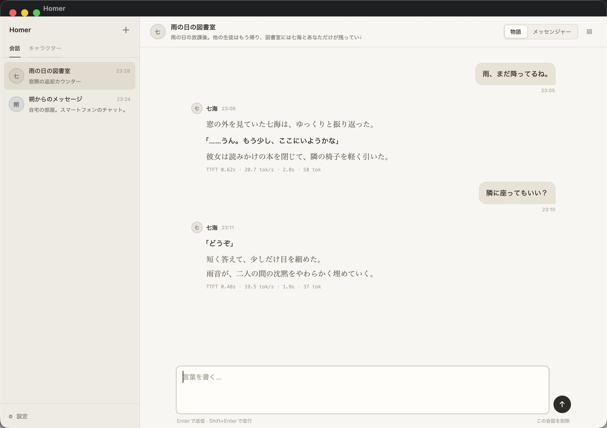
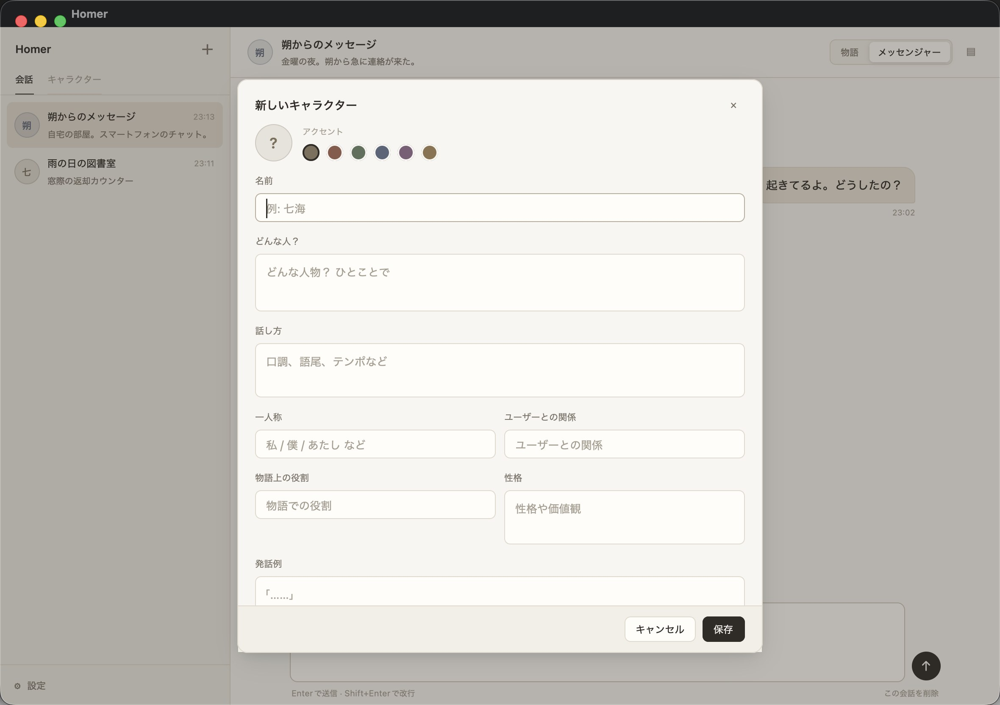
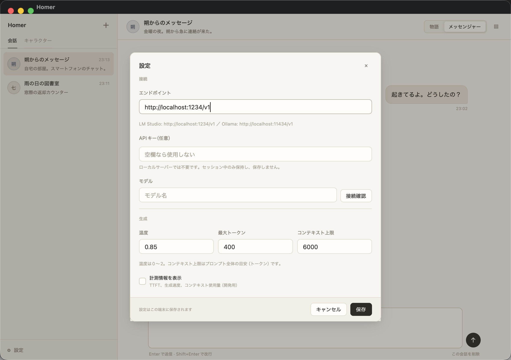
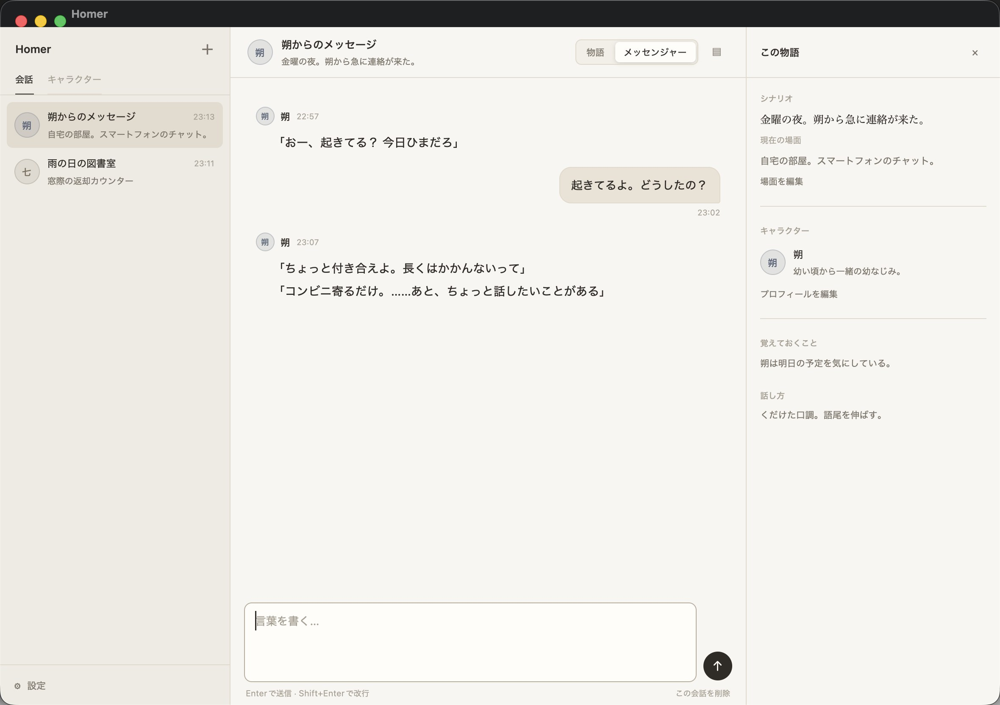

# Homer

ローカルLLMとキャラクターで物語を遊ぶ、macOS向けの小さなネイティブ・ロールプレイクライアント。
UIは **Rust + GPUI** で描画し、WebView / Tauri / Svelte は使用していません。

主役はキャラクターとユーザーです。Homerは目立たず、会話と物語の邪魔をしません。



## できること

- Telegram / Weixin 風の3ペイン・デスクトップUI（会話一覧・会話・設定パネル）
- キャラクター作成・編集（名前以外は任意）
  - 名前、説明、性格、話し方、一人称、関係、役割、発話例、追加設定、アクセント色
- 物語ごとのシナリオ・現在の場面・「覚えておくこと」の編集
- **Story Mode**（地の文＋セリフ）と **Messenger Mode**（セリフ中心）の切り替え
- OpenAI互換APIへのストリーミング接続（LM Studio / Ollama / カスタム）
- モデル一覧取得、接続確認、タイムアウト、エラー表示
- 生成中断（部分応答も保存）、再試行
- SQLiteによる永続化とマイグレーション
- 日本語IME対応の自前テキスト入力（GPUI `EntityInputHandler`）
- Enterで送信、Shift+Enterで改行
- 任意でTTFT / tok/s / 生成時間 / コンテキスト量を表示（開発用）

| キャラクター編集 | 設定 | 場面パネル |
| --- | --- | --- |
|  |  |  |

## 起動

### 必要なもの

- macOS / Apple Silicon（Metal）
- Rust 1.85以上（検証環境: 1.96.0）
- Xcode Command Line Tools
- LM Studio または Ollama（モデルの実行はHomerの責務外）

```bash
cargo run -p homer-app --release
```

デバッグビルドでも動きます（依存クレートは最適化済み）。

```bash
cargo run -p homer-app
```

データの保存先:

```
~/Library/Application Support/Homer/homer.db
```

初回起動時は空です。右上の「設定」→ エンドポイントとモデルを設定し、
キャラクターを作成して「新しい会話」を始めてください。

### キーボード

| キー | 動作 |
| --- | --- |
| Enter | 送信 |
| Shift + Enter | 改行 |
| ⌘ + N | 新しい会話 |
| ⌘ + , | 設定 |
| Esc | モーダルを閉じる |

## ローカルLLMへの接続

### LM Studio

1. LM Studioでモデルをロードし、Developerタブでサーバーを開始
2. Homerの設定でエンドポイントを `http://localhost:1234/v1` にする
3. 「接続確認」でモデル一覧を取得し、モデルを選択
4. 保存

### Ollama

```bash
ollama serve
ollama pull qwen2.5:7b   # 例
```

Homerの設定:

- エンドポイント: `http://localhost:11434/v1`
- モデル: `qwen2.5:7b`（`ollama list` の名前）

OllamaのOpenAI互換エンドポイントを利用します。ローカル接続ではAPIキーは不要です。

### カスタム / クラウド

`/v1` を含むOpenAI互換のベースURLを設定してください。必要な場合はAPIキーを入力できます。
**APIキーはセッション中のみメモリに保持し、SQLiteやログには保存しません。**
アプリを再起動すると再入力が必要です。

モデルのダウンロードや推論サーバーの起動は行いません。

## アーキテクチャ

```
crates/
  homer-app/        起動、Tokioランタイム、ウィンドウ生成
  homer-ui/         GPUI UI、状態管理、テキスト入力、画面
  homer-core/       ドメインモデル、Prompt Compiler、表示セグメント、トークン推定
  homer-storage/    SQLite、マイグレーション、CRUD
  homer-inference/  OpenAI互換HTTP、SSEパース、ストリーミング、キャンセル
scripts/
  mock_llm.py       手動確認用のOpenAI互換モック（LLMではない）
docs/screenshots/   UI確認用スクリーンショット
```

### データフロー

```
GPUI view (main thread)
  │  操作
  ▼
Services (Tokio)
  ├─ SQLite (homer-storage)          … 保存・履歴
  └─ OpenAI-compatible (homer-inference)
        └─ SSE delta ──► async-channel ──► 16msごとにまとめてUI更新
```

- UIスレッドではHTTPやSQLiteの完了を待ちません。
- ストリーミングは16ms単位でバッチし、トークンごとの過剰な再描画を避けます。
- 1ターンにつきLLM生成は1回です。マルチエージェントは使いません。
- 生成中断は `CancellationToken` で行い、それまでの部分応答を保存します。
- 会話切り替え時は進行中の生成をキャンセルします。

### Prompt Compiler

`homer-core/src/prompt.rs` が以下を1つのシステムプロンプトにまとめます。

1. 共通ルール（ユーザーの代弁禁止、Homerを名乗らない、メタ発言禁止）
2. キャラクター定義、話し方、一人称、関係、役割、発話例
3. シナリオ、現在の場面、覚えておくこと
4. Story / Messenger の出力形式
5. 最近の会話（予算に合わせて古いものから省略）

固定部分を先頭に置き、プロンプトキャッシュが効きやすい順序にしています。
コンテキスト予算は文字種を考慮した保守的なトークン推定で管理します。
応答中断で保存された未完了メッセージは表示されますが、次のプロンプトには含めません。

### User Agency

プロンプトでは次を明示的に禁止しています。

- ユーザーが言っていない台詞を書く
- ユーザーの感情・思考・行動を確定する
- ユーザーの選択肢を不必要に狭める

ただし、これはプロンプトによる制御であり完全な保証ではありません。
小型モデルほど逸脱の可能性は残ります。

## テストと検証

```bash
cargo fmt --check
cargo clippy --all-targets
cargo test
cargo build
```

検証結果（この環境）:

- `cargo fmt --check`: 成功
- `cargo clippy --all-targets`: 警告なし
- `cargo test`: **45 tests passed**
  - homer-core: 18（Prompt Compiler、トークン推定、Story/Messenger表示、日本語セグメント）
  - homer-inference: 14（SSE分割、順序、404/接続失敗、モデル一覧、JSONフォールバック、キャンセル）
  - homer-storage: 10（マイグレーション、CRUD、再起動後の復元、設定、meta）
  - homer-ui orchestration: 3（モックサーバーでの保存→ストリーミング→保存、接続失敗、キャンセル）
- `cargo build`: 成功
- macOS GUI起動: 成功（スクリーンショット取得済み）

手動GUI確認:

| シナリオ | 結果 |
| --- | --- |
| アプリ起動 | 成功（空状態・履歴あり両方） |
| キャラクター作成画面 | 表示確認。保存処理はstorageテストで検証 |
| 新規会話画面 | 表示確認。作成処理はstorageテストで検証 |
| モデルへのリクエスト | モックOpenAIサーバーで成功 |
| ストリーミング表示 | 成功（スクリーンショット） |
| 会話の保存 | SQLiteでユーザー／assistant両方を確認 |
| 再起動後の履歴復元 | 成功 |
| 接続失敗 | エラー内容と再試行ボタンを表示、ユーザー入力は保持 |

**実LLM（LM Studio / Ollama）はこの検証環境に存在しなかったため、推論品質と実測速度は未検証です。**
ストリーミングとUIの確認には `scripts/mock_llm.py` の固定応答を使用しており、実際のLLM応答として扱っていません。

```bash
python3 scripts/mock_llm.py
# 設定: http://127.0.0.1:18080/v1 / mock-7b
```

### GUI自動操作について

この環境ではGPUIウィンドウへのマウスイベント注入が安定して届かず、
ボタンクリックによる一部の画面遷移は自動確認できませんでした。
キーボード入力・Enter送信・ストリーミング・エラー表示は実際のウィンドウで確認しています。
モーダルや各画面は描画確認済みです。

## 既知の問題・制約

- `.app` バンドル、コード署名、公証は未対応。`cargo run` で起動する開発版です。
- マウス自動操作の制約により、UIクリック経由の作成フローは自動E2E未実施。
- テキストフィールド間のTab移動は未実装。クリックでフォーカスします。
- 長い入力は固定高のテキストエリア内でカーソルに追従してスクロールしますが、ホイールスクロールは未対応。
- 会話の再生成、分岐、検索、JSONエクスポート、Fast/Balanced/Qualityプロファイルは未実装。
- 長期記憶は会話ごとの「覚えておくこと」のみ。RAG / ベクトル検索はありません。
- 履歴が予算を超えた場合、古いメッセージは単純に省略されます（要約なし）。
- ダークモードは未対応。
- トークン数とtok/sは文字種ベースの推定値です。
- APIキーは設計上、再起動後に保持されません。
- Messenger Modeではナレーションを非表示にします（セリフが1つもない場合は表示）。
- assistantメッセージの保存に失敗した場合、生成テキストはDBに残りません。
- 設定のタイムアウトはリクエスト全体に適用されます。非常に長い生成では延長が必要です。

## 次の開発フェーズ

1. 実機LM Studio / Ollamaでの日本語応答品質・TTFB・tok/sの計測とプロンプト調整
2. マウス/キーボードを含むUI E2Eテスト、Tabフォーカス移動、アクセシビリティ
3. 再生成・分岐・会話検索・JSONエクスポート
4. 要約による長期記憶、シーンごとの記憶管理
5. `.app` バンドル、署名、初回起動オンボーディング
6. Fast / Balanced / Quality プロファイルとモデル別プリセット

## 開発メモ

- 計測情報は設定の「計測情報を表示」でONにできます。
- `HOMER_DEBUG_VIEW=settings|character|new-conversation|panel` を付けると、
  起動時に該当画面を開きます（スクリーンショット・確認用）。
- テスト用DBを消す場合:

```bash
rm -rf "$HOME/Library/Application Support/Homer"
```

## ライセンス

MIT
